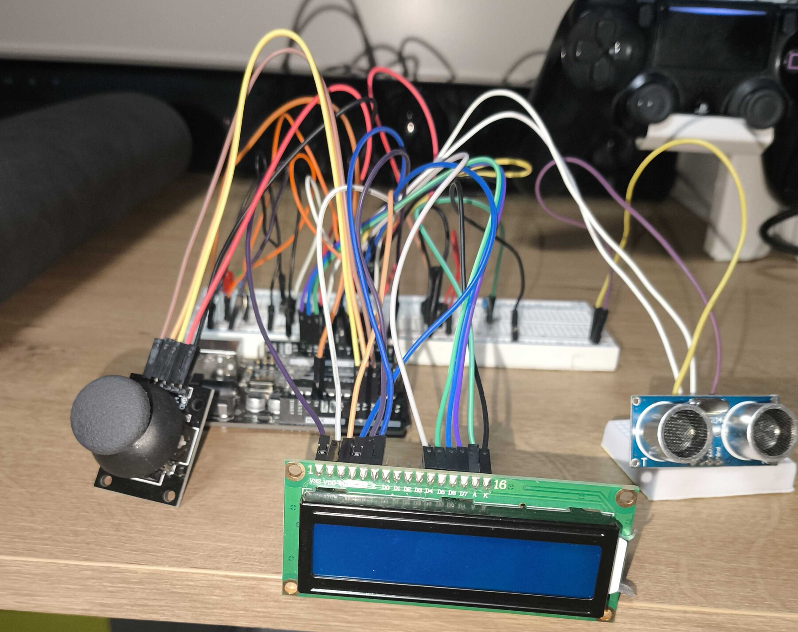
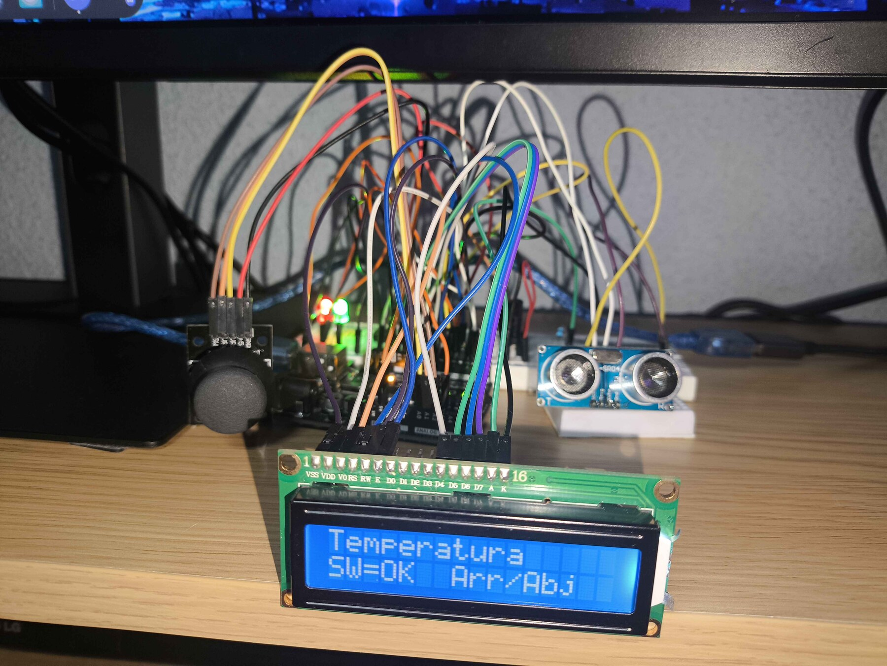
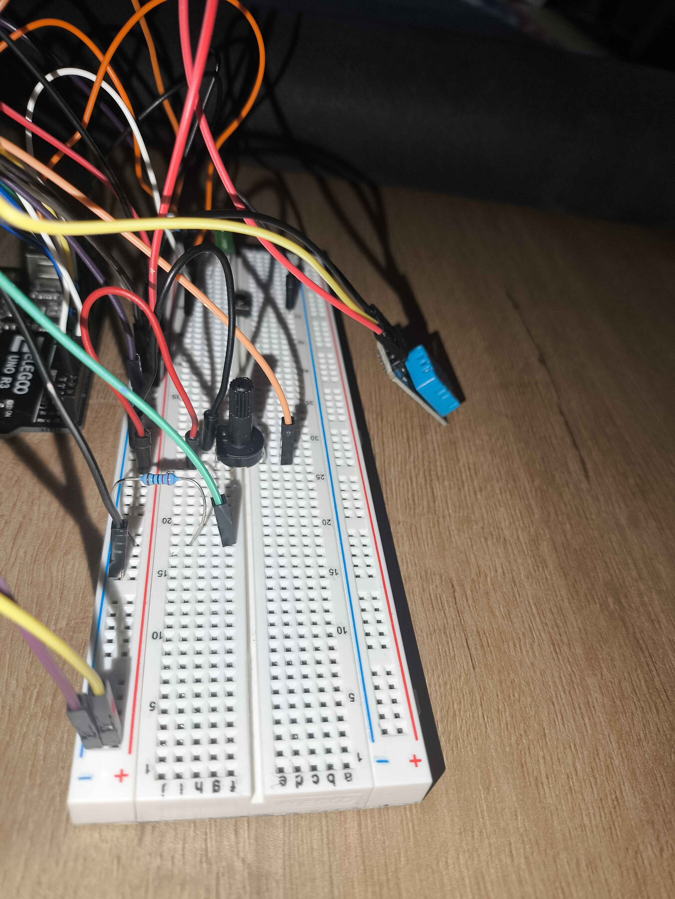
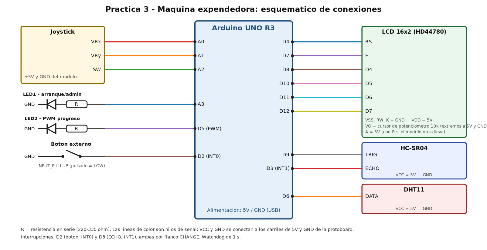

# Práctica 3 · Máquina expendedora de café (Arduino UNO R3)

## Montaje

Vista general del circuito (Arduino UNO R3, protoboard, LCD 16x2, joystick, sensor ultrasónico HC-SR04 y DHT11):

Montaje en funcionamiento, en modo administración (los dos LEDs encendidos y el menú en pantalla):

Detalle de la protoboard con el DHT11 y el potenciómetro de contraste del LCD:

## Esquemático

Esquema de conexiones pin a pin, generado a partir de las constantes del código:

### Conexiones

| Componente | Pin Arduino | Nota |
|---|---|---|
| Botón externo | D2 (INT0) | INPUT_PULLUP, interrupción CHANGE |
| Ultrasonidos ECHO | D3 (INT1) | interrupción CHANGE |
| Ultrasonidos TRIG | D9 | pulso de 10 µs |
| LED2 | D5 (PWM) | brillo = progreso de la bebida; resistencia en serie 220-330 ohm |
| LED1 | A3 | arranque y modo admin; resistencia en serie 220-330 ohm |
| DHT11 | D6 | temperatura y humedad |
| Joystick X / Y | A0 / A1 | analógicas |
| Joystick SW | A2 | INPUT_PULLUP |
| LCD 16x2 | RS=4, E=7, D4..D7 = 8, 10, 11, 12 | LiquidCrystal en modo 4 bits. VSS y RW a GND, VDD a 5V, VO al cursor de un potenciómetro de 10k (extremos a 5V y GND), A a 5V (con resistencia si el módulo no la lleva), K a GND |

## Descripción de la solución

El programa es una **máquina de estados no bloqueante**: no usa `delay()` (salvo los microsegundos del pulso TRIG) y todo el tiempo se controla comparando `millis()`. Tiene tres modos: `ARRANQUE` (3 s, LED1 parpadeando a 500 ms), `SERVICIO` (cliente) y `ADMIN`. Dentro de cada modo hay un enum con sus subestados.

## Funcionamiento

`loop()` lee los eventos, actualiza los sensores y ejecuta el estado correspondiente. El estado principal es el enum `Modo` y Servicio y Administración tienen a su vez subestados.

**Arranque.** El LCD muestra "CARGANDO..." y LED1 parpadea tres veces (500 ms encendido, 500 ms apagado). El tiempo se calcula con `millis()`. Después pasa solo a SERVICIO.

**Servicio.**
1. ESPERANDO: se muestra "ESPERANDO / CLIENTE" hasta que el ultrasónico mide menos de 100 cm.
2. MOSTRAR_AMBIENTE: durante 5 s se muestran temperatura y humedad.
3. SELECCIONANDO: el joystick recorre los cinco productos (Café Solo 1,00, Café Cortado 1,10, Café Doble 1,25, Café Premium 1,50, Chocolate 2,00 EUR) y SW confirma.
4. PREPARANDO: tiempo pseudoaleatorio entre 4 y 8 s, distinto del anterior. Cada 50 ms se actualiza el porcentaje en el LCD y el brillo de LED2 por PWM.
5. ENTREGANDO: "RETIRE BEBIDA" durante 3 s y vuelta a ESPERANDO.

El botón externo cancela la operación si se suelta entre 2 y 3 s después de pulsarlo.

**Administración.** Se entra y se sale manteniendo el botón externo 5 s. Con ambos LEDs encendidos, el menú ofrece Temperatura, Distancia, Contador (segundos desde el arranque) y Modificar precio. Los precios se editan de 5 en 5 céntimos, SW confirma y mover el joystick a la izquierda descarta el cambio. Los precios se guardan en RAM (no se usa EEPROM), así que al reiniciar vuelven a los valores iniciales.

## Correspondencia entre funciones y tareas

| Función | Responsabilidad |
|---|---|
| `setup()` / `loop()` | Inicialización de pines, LCD, DHT, interrupciones y watchdog; coordinación del programa |
| `actualizarArranque()` | Tres parpadeos temporizados de LED1 |
| `actualizarServicio()` | Espera, ambiente, catálogo, preparación y entrega |
| `actualizarAdmin()` | Menú, consultas, edición de precios y retroceso |
| `actualizarUltrasonico()` / `interrupcionEco()` | Pulso TRIG y medida de la duración del eco sin `pulseIn()` |
| `actualizarBotonExterno()` / `interrupcionBoton()` | Antirrebote y distinción de pulsaciones por duración |
| `leerJoystick()` | Convierte ejes y pulsador en eventos discretos |
| `actualizarDHT()` | Lectura periódica de temperatura y humedad |
| `iniciarPreparacion()` / `actualizarPreparacion()` | Duración aleatoria, progreso y PWM |

### Recursos utilizados y por qué

| Recurso | ¿Usado? | Por qué |
|---|---|---|
| **Interrupciones hardware** | Sí | El botón (D2) y el ECHO (D3) son eventos asíncronos: la ISR solo anota el instante (`micros()`) y el estado, y el `loop` procesa. Así no se pierde ninguna pulsación ni se mide mal el eco. |
| **Watchdog** (`wdt_enable(WDTO_1S)`) | Sí | Si el programa se cuelga, la placa se reinicia sola en 1 s. El `loop` tarda como mucho ~35 ms (lectura del DHT11), así que `wdt_reset()` al inicio del `loop` es seguro. |
| **Threads** (ArduinoThread) | No | No hacen falta: el `loop` cooperativo con `millis()` ya reparte el tiempo entre sensores, pantalla y botones, y evita el coste de memoria en un UNO. |
| **PWM** | Sí | `analogWrite` sobre LED2 simula el progreso de preparación (0–255 en 4–8 s). |
| **ATOMIC_BLOCK** | Sí | Copia segura de las variables `volatile` compartidas con las ISR (el AVR es de 8 bits y una lectura de 32 bits no es atómica). |

### Detalles de diseño
- **Antirrebote**: botón externo 35 ms (con el instante del último flanco que da la ISR) y SW del joystick 35 ms.
- **Botón externo**: 5 s mantenido cambia entre SERVICIO y ADMIN; soltarlo entre 2 y 3 s en SERVICIO cancela la operación.
- **Ultrasonidos**: medida cada 80 ms, `distancia = duración / 58`; con `timeout` de 30 ms si no llega eco. Cliente detectado a < 100 cm.
- **DHT11**: lectura cada 2,5 s y solo cuando no hay un eco pendiente, para que su lectura (que bloquea unos ms) no estropee la medida de distancia.
- **Joystick**: un eje solo genera un evento al salir de la zona muerta (420–600), "rearmándose" al volver al centro, para que un solo empujón sea un solo movimiento.
- **Tiempo de preparación**: `random(4000, 8001)` con `randomSeed(analogRead(A4))` (A4 sin conectar) y nunca repite el valor anterior.
- **Precios** en céntimos (`int`) para evitar decimales; en admin se editan de 5 en 5 y se descartan con izquierda.

## Librerías y limitaciones

Librerías: `LiquidCrystal.h`, `DHT.h`, `avr/wdt.h`, `util/atomic.h` y `math.h`. No se usan ArduinoThread, TimerOne ni EEPROM.

No hay `delay()` en milisegundos; solo `delayMicroseconds(2)` y `delayMicroseconds(10)` para generar el pulso TRIG. Las lecturas de las librerías y del LCD tienen una duración finita, por lo que no se afirma tiempo real estricto.

Semilla aleatoria: `randomSeed(analogRead(A4))` con A4 sin conectar. Por el puerto serie (9600 baudios) se imprimen los cambios de modo y la duración de cada preparación.

## Código
Ver `maquina_expendedora.ino` (incluido en la entrega).
